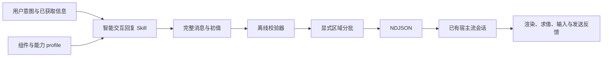

# 架构

`skills/agenui-reply/` 为自包含交付单元。SKILL.md 仅承载意图、资源路由、生成与校验；components 每组件定义/说明，capabilities 每函数签名/说明及版本化 profile，references 保存组件场景选择、视觉、协议、流式与宿主规则。examples 为可直接消费的完整/流式文件。vendor 保存只读上游快照和许可。scripts 不依赖仓库外运行资源。

工具由 Node.js 22+ ESM 运行，Ajv 8.17.1 与 ajv-formats 3.0.1 锁版本。首次 `npm ci` 获取包，此后校验/分批无需联网；协议资料始终来自本地。`package-lock.json` 可复现安装。未包含浏览器或客户端依赖。

catalog.mjs 构建内存有效 schema，保留 vendor 原文；validator.mjs 处理消息封装、Ajv 属性检查及图/路径/类型/动作语义检查；expressions.mjs 递归下降解析模板，只产生路径与调用语法节点；stream.mjs 执行依赖后序遍历及全量 root 替换。解析过程不执行 DSL、不使用 eval。Ajv 的编译属于 schema 检查实现。

校验状态以 Surface 为单位保存完整组件 Map、数据模型、输入路径和源消息坐标。同 ID 完全替换。每个组件批次结束检查引用和绑定；流结束要求存活 Surface 有 root。existing 假设同名 Surface 已存在，new 强制创建。`--state` 仅导入宿主数据，不导入组件树，因此需要验证完整的组件更新流。

诊断结构为 `{file,index,pointer,code,message}`，index 为从 1 开始的消息号，Pointer 以该消息为根；跨批保留组件的错误指向原始定义。中文说明与稳定错误码配合。格式/内容错误退出 1，配置/IO/工具错误退出 2，成功退出 0。

分批器仅支持单个静态 root Column。区域必须保持原 children 顺序、覆盖且无重复；自动发送完整依赖，root 累加已显示区域。所有初值提前发送一次，避免后续批次覆盖用户修改。原始完整消息有不可达组件则拒绝无损分批。复杂结构由调用方直接生成 NDJSON 再校验。
